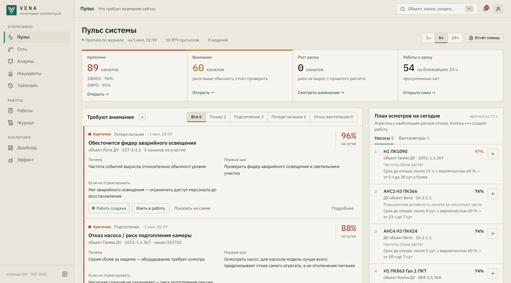
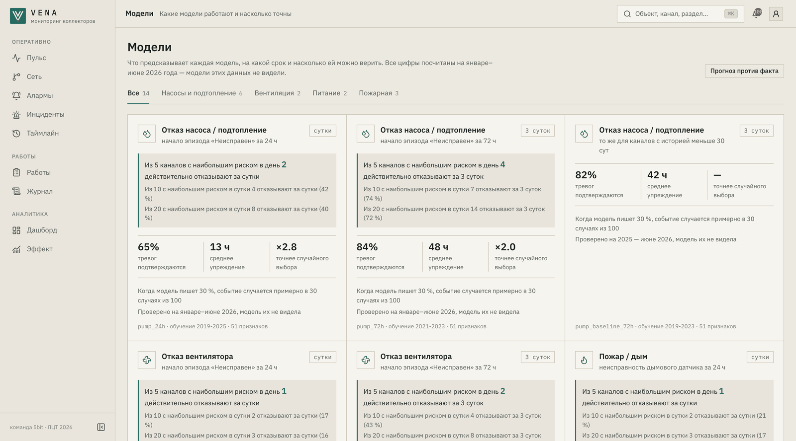
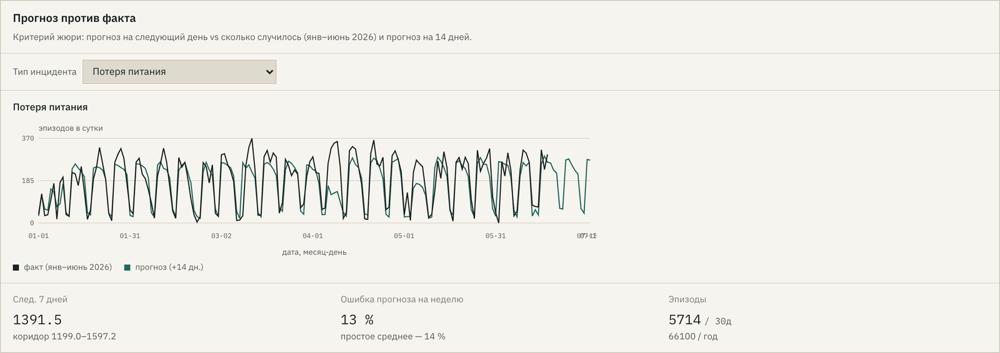
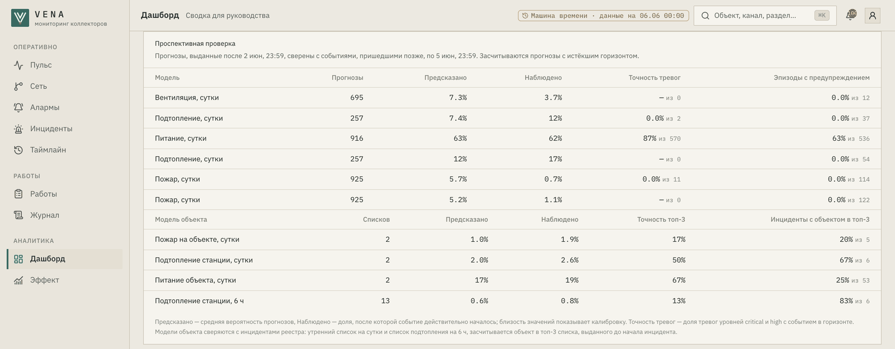
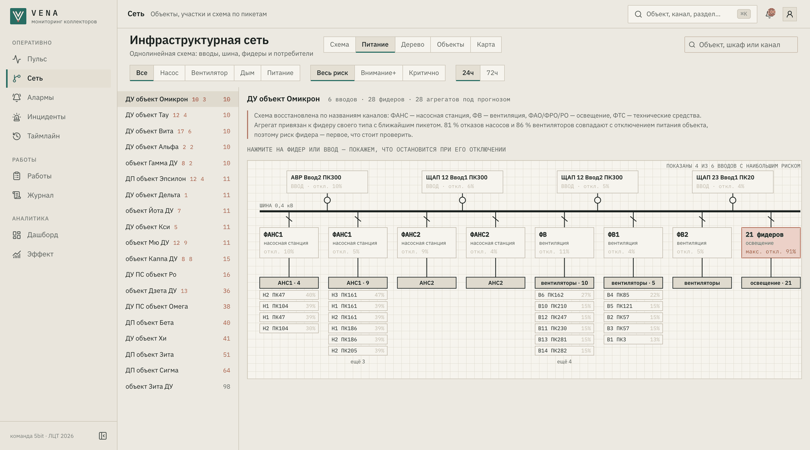

<div align="center">

# VENA

### Прогноз инцидентов в инженерных коллекторах Москвы

**Команда 5bit** · Кейс №8 «Москоллектор» · Лидеры цифровой трансформации 2026

## [5bit.online](https://5bit.online)

</div>

| Стенд | |
|---|---|
| Интерфейс | **https://5bit.online** |
| REST API (OpenAPI) | https://5bit.online/docs |
| Проверка работоспособности | https://5bit.online/api/v1/health |
| Вход для проверки | `user1` / `0987654321` — администратор; `user2`–`user20` с тем же паролем — диспетчеры |

## Решение

VENA читает журнал событий СМВУ и заранее говорит диспетчеру, где в ближайшие 6–72 часа откажет насос, вентиляция, питание или пожарная сигнализация, с какой вероятностью, почему и что проверить первым.

- **Диспетчер** получает инцидент по объекту и сценарию: калиброванную вероятность, причину простым языком, первый шаг, последствия бездействия и черновик работы. Серии плановых проверок отделены от реальных тревог, у каждой тревоги есть вероятность подтверждения.
- **Эксплуатация** получает утренний список объектов и план осмотров на день: насосы и вентиляторы с наибольшим риском и сроком до отказа насоса.
- **Руководитель** видит эффект по журналу решений, прогноз против факта, прогноз нагрузки на 14 дней и окупаемость утреннего списка.
- Решение остаётся за человеком: VENA читает данные СМВУ и не управляет оборудованием. Решения диспетчеров с причинами и исходы работ сохраняются в журнале и выгружаются как размеченные пары для дообучения.



## Сильные стороны

| | |
|---|---|
| **Вероятность, а не балл** | изотоническая калибровка на невиденном периоде: 30 % на экране — около 30 случаев из 100; ECE моделей 0,001–0,038 |
| **События объекта, а не состояния датчика** | в журнале нет меток аварий; реестр по правилам заказчика превращает состояния в пожары, подтопления и отключения питания, модели объекта обучены на этих событиях |
| **Подтопление за 6 ч** | модель на 6 ч пересчитывается на каждом пакете потока; за 6 ч до начала подтопления станция в топ-3 в 63–65 % случаев при 17 % у случайного порядка |
| **Проверка тревоги до выезда** | 71 % тревог дыма и газа — серии ППР, они помечены отдельно; модель подтверждения отсеивает 36 % неподтверждающихся тревог при 90 % сохранённых |
| **Почему и что делать** | причина каждого прогноза из вкладов признаков (SHAP), переведённая на язык диспетчера; первый шаг и последствия — из каталога рекомендаций |
| **Питание — первопричина** | 81 % отказов насосов и 86 % вентиляторов совпадают с отключением питания объекта; схема питания показывает, что остановится при отключении фидера |
| **Индекс здоровья объекта** | 0–100 из моделей объекта; средняя точность 0,83 против 0,73 у прежнего индекса, ошибка калибровки 0,013 против 0,054 |
| **Машина времени** | реальный журнал проходит через тот же поток СМВУ, что и в эксплуатации; симуляция диспетчера принимает решения, прогноз сверяется с фактом |
| **Порог по деньгам** | порог и размер списка выбираются по стоимости ошибки: калькулятор окупаемости и кривые точности, полноты и нагрузки на экране порогов |
| **Полный цикл работы** | уведомление → «Взять в работу» → черновик → утверждение или отклонение с причиной → заявка в службу → исход → дообучение |

## Данные

| Источник | Объём |
|---|---|
| Журнал СМВУ | 313,5 млн событий с 01.01.2019 по 30.06.2026, 19 типов датчиков |
| Справочник каналов | 11 485 каналов на 78 объектах: объект, секция, тип системы, пикет |
| Справочник состояний | названия состояний и признак «тревожное»; 99,8 % значений журнала сопоставлены |
| Внешние данные | Open-Meteo: архив осадков и прогноз на 7 дней, производственный календарь |

Меток отказов, пожаров и проникновений в журнале нет. Цели восстановлены из состояний каналов: начало эпизода «Неисправен», «Обесточен», «Затоплен», срабатывание дыма. Реестр инцидентов собирается по правилам из [`ml/configs/incidents.json`](ml/configs/incidents.json):

| Инцидент | Правило | За 7,5 лет |
|---|---|---|
| пожарный | «Обнаружен дым» на 2+ датчиках объекта за 15 мин вне серии ППР | 1 429 |
| подтопление | «Затоплен» у 2+ насосов станции в пределах часа или дольше 30 мин | 3 330 |
| отключение питания | «Обесточен» у 3+ фидеров объекта за 5 мин | 43 862 |

## Модели

Протокол: обучение до 2024 года → выбор модели и параметров на 2025 → переобучение по 2025 → отчёт на январе–июне 2026, который не участвовал ни в обучении, ни в подборе параметров. Перед границей обучения — зазор 168 ч, признаки строятся только по прошлому, калибровка обучается на выходах модели за 2025 год. По 2026H1 один раз решается, заменить ли текущую модель переобученной, поэтому его метрики немного оптимистичны; независимую проверку дают машина времени и сверка прогнозов после конца журнала.

| Модель | Что прогнозирует | Алгоритм | Доля событий | AP | Лучше случайного | Точность топ-5 в сутки |
|---|---|---|---|---|---|---|
| `pump_24h` / `pump_72h` | отказ насоса за 24 / 72 ч | LogReg + LightGBM | 0,117 / 0,259 | 0,329 / 0,508 | ×2,8 / ×2,0 | 0,42 / 0,76 |
| `fan_24h` / `fan_72h` | отказ вентилятора за 24 / 72 ч | CatBoost | 0,042 / 0,092 | 0,240 / 0,540 | ×5,7 / ×5,9 | 0,18 / 0,44 |
| `smoke_24h` | неисправность дымового датчика | CatBoost | 0,009 | 0,271 | **×30,8** | 0,24 |
| `smoke_alarm_24h` | срабатывание дымового датчика | CatBoost | 0,018 | 0,218 | ×12,3 | 0,20 |
| `phase_24h` | потеря питания фидера | CatBoost | 0,253 | 0,751 | ×3,0 | 0,96 |
| `flood_24h` | затопление камеры | LightGBM | 0,086 | 0,254 | ×2,9 | 0,33 |
| `alarm_30m` | подтверждение тревоги за 30 мин | LightGBM | 0,792 | 0,909 | ×1,15 | — |
| `object_power_24h` | отключение питания объекта по реестру | LightGBM | 0,535 | 0,840 | ×1,6 | 0,73 |
| `object_flood_24h` | подтопление станции по реестру | LightGBM | 0,068 | 0,280 | ×4,1 | 0,19 |
| `object_flood_6h` | подтопление станции в ближайшие 6 ч | LightGBM | 0,021 | 0,185 | ×8,7 | — |
| `object_fire_24h` | пожарный инцидент объекта | LightGBM | 0,019 | 0,214 | ×11,1 | 0,07 |

Значения — январь–июнь 2026, источник [`ml/results/models.json`](ml/results/models.json). AP читается относительно доли событий: у случайного ранжирования AP равна этой доле, поэтому колонка «Лучше случайного» = AP / доля событий. Для редких событий важна именно кратность: неисправность дымового датчика случается в 0,9 % случаев, и AP 0,271 — в 31 раз лучше случайного выбора. Для частых событий (питание объекта — 54 %) потолок кратности низкий, и показательна точность списка: из пяти объектов с наибольшим риском инцидент наступает у 73 %. У `alarm_30m` задача другая — отсеять неподтверждающиеся тревоги: модель отсеивает 36 % из них и сохраняет 90 % подтверждающихся. Для каналов с короткой историей насос оценивает `pump_baseline_72h` (логистическая регрессия).

Поверх моделей:

- **утренний список объектов** — точность топ-3: питание 0,78, насосы (72 ч) 0,73, вентиляторы (72 ч) 0,70 при ориентире заказчика 0,7;
- **индекс здоровья объекта** — объединение вероятностей моделей объекта со сглаженной калибровкой по 2025 году;
- **срок до отказа насоса** — квантильный LightGBM: медиана и интервал 20–80 %, на 2026H1 интервал накрыл 63 % фактических сроков;
- **прогноз нагрузки на 14 дней** с 80 % интервалом: ошибка недельной суммы 13 % для потери питания, 38 % для затопления камер;
- **индекс проверки доступа** — ранжирование срабатываний точек входа на охране; меток проникновений нет, поэтому это индекс, а не вероятность.

Все проверенные подходы, включая отклонённые, — в [ml/README.md](ml/README.md) и [`ml/experiments`](ml/experiments).



## Проверка на реальных данных

**Реальные инциденты 2026H1.** Для каждого инцидента реестра проверено, был ли объект в топ-3 списка за 6 ч до начала ([`ml/results/scenarios`](ml/results/scenarios)):

| Инцидент | Модель объекта | Список каналов | Случайный порядок |
|---|---|---|---|
| подтопление | **65 %** (модель на 6 ч — 63 %) | 50 % | 17 % |
| пожарный | **56 %** | 41 % | 12 % |
| отключение питания | 21 % | **28 %** | 16 % |

**Прогноз нагрузки против факта.** Прогноз числа эпизодов на следующий день против фактического, январь–июнь 2026, и прогноз на 14 дней с 80 % интервалом:



**Поток.** Повтор журнала через API: 64 457 событий, 72 пакета, от пакета до нового снимка прогнозов медиана 24 с, p95 48 с при норме 300 с ([`ml/results/stream_replay.json`](ml/results/stream_replay.json)).

## Имитация работы на реальных данных

**Задача:** показать, что модели актуальны: прогноз, выданный по реальному журналу, сбывается, а сервис работает на нём так же, как в эксплуатации.

**Что сделано — «Машина времени»** (Настройки → Интеграции, роль администратора):

1. Администратор выбирает окно реального журнала СМВУ (до 31 суток), скорость (1 ч, 6 ч или сутки журнала за 10 с) и включает симуляцию диспетчера.
2. ML-воркер откатывает историю к началу окна: прогнозы считаются только по событиям до этого момента, как в тот день.
3. События окна идут пакетами через тот же `POST /api/v1/smvu/events`, что и поток СМВУ в эксплуатации. Прогнозы пересчитываются по каждому пакету, на «Пульсе» загораются инциденты, создаются уведомления и черновики работ.
4. Симуляция диспетчера решает по черновикам. Если в горизонте прогноза на канале или на канале того же типа на объекте наступило целевое событие, черновик подтверждается. Иначе он отклоняется с причиной из справочника. 15 % черновиков остаются человеку. Решения попадают в журнал и на экран «Эффект».
5. Панель «Проспективная проверка» на дашборде сверяет каждый выданный прогноз с событиями, пришедшими позже: предсказанная и наблюдаемая доля событий, точность тревог, доля предупреждённых эпизодов. Для моделей объекта — сколько инцидентов реестра стояли в топ-3 списка, выданного до их начала.
6. «Вернуть живой режим» удаляет события воспроизведения по префиксу, отменяет открытые черновики и возвращает ML к полному журналу.

**Учебные сценарии.** Реальный инцидент января–июня 2026 (пожар, подтопление или отключение питания) повторяется в потоке со сдвигом во времени тремя этапами: предвестники, развитие, инцидент. Видно, за сколько часов до события объект попал в утренний список. Каталог собирает `ml/scenario.py --catalog`.

**Результаты:**

- 3–6 июня 2026, 4 дня, 45 874 события, скорость «1 ч журнала за 10 с» ([`ml/results/time_machine_2026-06-03.json`](ml/results/time_machine_2026-06-03.json)): тревоги по питанию подтвердились в 87 % случаев (665 тревог), заранее предупреждён 61 % эпизодов отключения; точность топ-3 утреннего списка по питанию 78 %; у 5 из 7 подтоплений станция была в топ-3 суточного списка и у 6 из 9 — в списке на 6 ч; симуляция — 93 подтверждения, 31 отклонение с причиной, 23 решения оставлены человеку.
- Окно стенда по умолчанию, 3–5 июня, 33 778 событий: тревоги по питанию — 87 % из 570; у 5 из 6 подтоплений станция была в топ-3 списка на 6 ч; симуляция — 81 / 15 / 10.

Как повторить: Настройки → Интеграции → «Машина времени» → окно 03.06.2026–07.06.2026, скорость «1 ч журнала за 10 с» → «Запустить». Подготовка истории занимает около 5–10 минут. Через API: `POST /api/v1/replay/week`, `POST /api/v1/replay/scenario`, `POST /api/v1/replay/stop`. Из терминала: `VENA_TOKEN=<JWT> python ml/replay_journal.py --start 2026-06-01 --end 2026-06-08`.

Код: `backend/app/domain/replay.py` (окно, пакеты, откат истории), `backend/app/domain/replay_dispatcher.py` (симуляция диспетчера), `backend/app/domain/replay_scenarios.py` (учебные сценарии), `ml/stream_scoring.py` (поток и откат истории), `ml/pipeline/prospective.py` (прогноз против факта).



## Как это работает

```
браузер ─HTTPS─▶ Caddy ─┬─▶ frontend   Next.js 16, React 19
                        └─▶ backend    FastAPI ─▶ PostgreSQL 16
                                 │  ▲
                   пакеты потока │  │ snapshot.json
                                 ▼  │
                            ml-worker   замороженные модели CatBoost / LightGBM / LogReg
                                 ▲
             журнал СМВУ, справочник каналов (CSV / XLSX / API)
```

1. **ML-воркер** строит признаки каждого канала на момент последнего события, применяет модели и калибровку и атомарно публикует снимок прогнозов. В потоке пересчитываются только каналы из нового пакета, раз в сутки — всё.
2. **Backend** забирает снимок, собирает прогнозы уровней `critical` и `attention` в инциденты по объекту и сценарию, создаёт уведомления и черновики работ. Работы, решения, история оценок, пользователи, аудит и очередь писем хранятся в PostgreSQL.
3. **Интерфейс** ведёт диспетчера от инцидента до результата работы.

| Экран | Назначение |
|---|---|
| Пульс | что требует внимания сейчас, план осмотров на день |
| Инциденты | утренний список объектов по сценариям, подтопление на 6 ч, реестр инцидентов |
| Сеть | схема объекта по пикетам, схема питания с каскадом отключений, карта |
| Алармы | нагрузка по ISA-18.2, серии ППР, проверка тревоги перед выездом, доступ |
| Таймлайн | индекс здоровья участка и события канала |
| Работы, Журнал | план работ, решения с причиной, исходы, выгрузка для дообучения |
| Дашборд, Эффект | сводка для руководителя, прогноз против факта, отчёты XLSX, PDF, CSV, XML |
| Модели | карточки моделей на языке диспетчера, точность на уровне объекта, окупаемость списка |
| Настройки | пороги и горизонты, уведомления, интеграции, машина времени, пользователи, аудит |



## Технологии

| Слой | Стек |
|---|---|
| ML | Python 3.12, CatBoost, LightGBM, scikit-learn, pandas, DuckDB, PyArrow |
| Backend | FastAPI, SQLAlchemy 2, Alembic, PostgreSQL 16, APScheduler, ldap3, Argon2, ReportLab, openpyxl |
| Frontend | Next.js 16, React 19, TypeScript, TanStack Query, Tailwind CSS 4, Feature-Sliced Design |
| Эксплуатация | Docker Compose, Caddy (HTTPS, TLS 1.3), GitHub Actions: деплой с резервной копией, smoke-проверкой и откатом |

Интеграции: поток СМВУ в JSON и XML, импорт журнала и справочников CSV/XLSX, синхронизация реестра оборудования, система заявок со статусами, LDAP/AD с ролями и областями видимости, SMTP с эскалацией, GeoJSON и WKT, 90 путей REST API.

## Запуск

Требования: Docker 24+ и Docker Compose v2. Для разработки без Docker — Python 3.12, Node.js 22, pnpm 10.

```bash
docker compose up -d --build
```

Поднимаются PostgreSQL 16, ML-воркер, backend, интерфейс и эмулятор системы заявок; тестовый каталог LDAP — `docker compose --profile ldap up -d`. Первая сборка — около 10 минут. Когда `docker compose ps` показывает сервисы `healthy`:

- интерфейс — http://localhost:3100, вход `user1` / `0987654321`;
- API — http://localhost:8100/docs.

Журнал СМВУ в репозиторий не входит. Если до запуска положить `ext-journal-*.csv` и `справочник_каналов_датчиков.csv` в `ml/dataset`, прогнозы строятся по реальным каналам. Без журнала те же замороженные модели оценивают демонстрационные каналы, и интерфейс помечает снимок как демонстрационный.

Переменные окружения, разработка без Docker и переобучение — [docs/installation.md](docs/installation.md), сервер и автодеплой — [infra/README.md](infra/README.md).

## Проверки

```bash
cd backend && uv run ruff check . && uv run mypy app && uv run pytest    # 192 теста, нужен PostgreSQL
cd frontend && pnpm lint && pnpm typecheck && pnpm test && pnpm build    # 98 тестов
cd ml && python -m pytest                                                # 145 тестов
```

Нагрузка: 20 пользователей одновременно — медиана экрана 0,45 с, p95 0,90 с, ошибок нет. Восстановление базы из резервной копии — 21 с.

## Соответствие ТЗ

| Требование | Реализация |
|---|---|
| прогноз отказов и инцидентов с горизонтом ≥ 24 ч | 12 прогнозных моделей с калиброванной вероятностью на 6, 24 и 72 ч и модель проверки тревог; `GET /api/v1/predictions`, `GET /api/v1/incidents/objects` |
| локация, классификация инцидентов | объект → секция → канал → пикет; сценарии пожар, подтопление, потеря питания, отказ вентиляции |
| раннее выявление пожаров и подтоплений | реестр инцидентов и модели объекта, подтопление за 6 ч, проверка на реальных инцидентах 2026H1 |
| верификация доступа | индекс проверки срабатываний и маршрут по пикетам (разметки проникновений нет) |
| уведомления, рекомендации, черновики заявок | уведомления в интерфейсе и по почте, первый шаг по сценарию, черновик работы по каждому инциденту |
| сценарий диспетчера | уведомление → верификация → решение с причиной из справочника → журнал → выгрузка для дообучения (`GET /api/v1/ml/feedback`) |
| данные CSV/XLSX, поток по API, реестр оборудования | `POST /api/v1/imports`, `POST /api/v1/smvu/events` (JSON, XML), `PUT /api/v1/equipment`, синхронизация по расписанию |
| JSON, XML, PostgreSQL, GeoJSON, WKT | весь API в JSON; приём и выгрузка XML; PostgreSQL 16; импорт и выгрузка GeoJSON и WKT |
| метеоданные | Open-Meteo: архив и прогноз на 7 дней |
| дашборд, карта, журнал прогнозов, пороги | Пульс, Сеть, Журнал, «Пороги и горизонты» с точностью, полнотой и нагрузкой на 2026H1 |
| отчёты PDF и XLSX, сезонная аналитика | отчёт руководителю и отчёт смены, сезонность и прогноз на 14 дней |
| прогноз ≤ 300 с, ≥ 20 пользователей | 24 с медиана потока; 20 пользователей без деградации |
| резервное копирование, восстановление ≤ 4 ч | ежедневные копии 14 дней, дамп перед деплоем, восстановление 21 с |
| TLS, LDAP/AD, RBAC, аудит | TLS 1.3, LDAP + StartTLS / LDAPS, роли viewer, dispatcher, admin, области видимости, журнал аудита |

Ограничения: прогнозируется состояние канала в журнале, а не подтверждённый физический отказ; правила реестра и каталог рекомендаций нужно согласовать с заказчиком; без загрузки GeoJSON/WKT карта строится по условной геометрии; LDAP/AD, учётная система и система заявок подключаются по адресам заказчика.

## Структура репозитория

```
backend/      FastAPI: API, инциденты, работы, журнал, уведомления, импорт, поток СМВУ, машина времени, RBAC, аудит
  app/api/routes   эндпоинты /api/v1
  app/domain       бизнес-логика
  migrations       миграции Alembic
frontend/     Next.js, Feature-Sliced Design: app, views, widgets, features, entities, shared
ml/           данные, признаки, обучение, замороженные модели, снимок и поток
  pipeline         события, признаки, калибровка, реестр инцидентов, модели объекта
  configs          правила реестра, пороги, рекомендации
  results          метрики и витрины, на которых построены выводы
  experiments      проверенные подходы с результатами
infra/        production: compose, Caddy, деплой, резервные копии, нагрузочный тест
emulators/    эмуляторы системы заявок и LDAP для локальной проверки
docs/         документация
```

## Документация

| Документ | Содержание |
|---|---|
| [docs/architecture.md](docs/architecture.md) | компоненты, потоки данных, хранение, безопасность |
| [docs/methods.md](docs/methods.md) | обработка данных, постановки, валидация, калибровка, реестр инцидентов |
| [docs/business.md](docs/business.md) | ценность для диспетчера и эксплуатации, порог безубыточности, внедрение, KPI |
| [docs/installation.md](docs/installation.md) | запуск, переменные окружения, переобучение, резервные копии |
| [docs/data-integrations.md](docs/data-integrations.md) | загрузка журнала, поток СМВУ, реестр оборудования, система заявок |
| [docs/authentication.md](docs/authentication.md) | вход, роли, области видимости, LDAP/AD |
| [docs/email-notifications.md](docs/email-notifications.md) | SMTP, правила, очередь писем |
| [docs/libraries.md](docs/libraries.md) | библиотеки и версии |
| [ml/README.md](ml/README.md) | ML: данные, модели, проверенные подходы, воспроизведение |
| [infra/README.md](infra/README.md) | сервер, HTTPS, автодеплой, откат, резервные копии |
